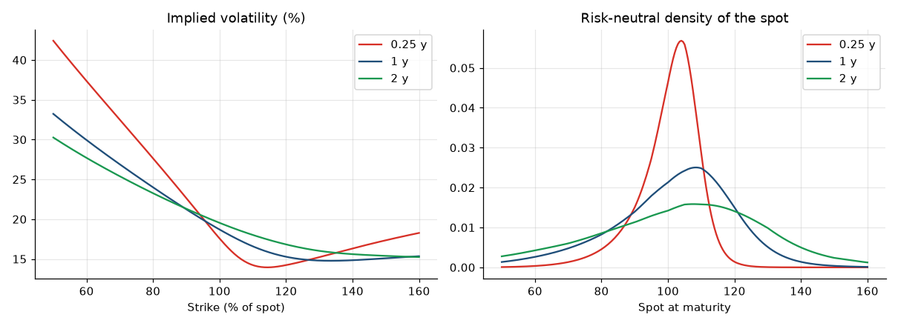
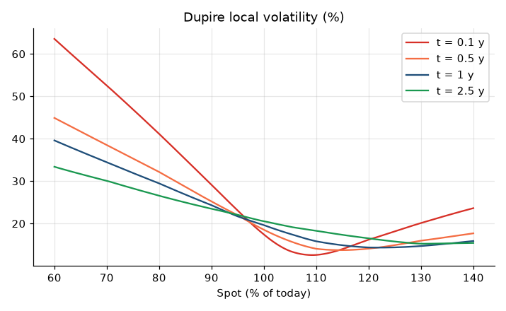
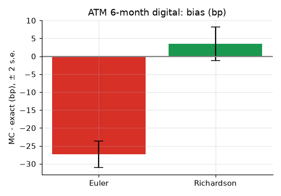
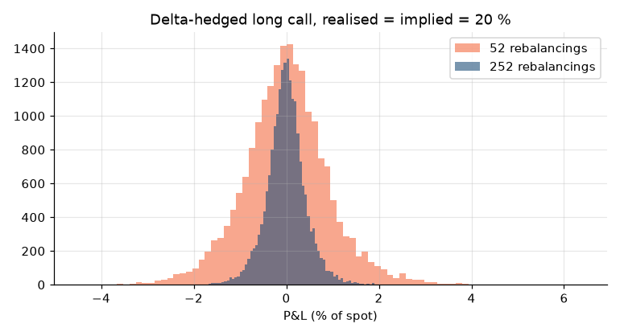

# Structured Products Pricer

[](https://github.com/maxenceherve/structured-products-pricer/actions/workflows/ci.yml)


Price, decompose, explain and hedge vanilla option strategies and structured products, with an
interactive Streamlit app. Written from the textbook formulas (Hull, Wilmott, Haug, Glasserman,
Gatheral), and checked against closed forms, QuantLib and Monte Carlo — every Monte Carlo number
comes with its standard error.

> Educational project. Market data are synthetic or typed by the user. Nothing here is
> investment advice.


## What you can do

| Page | What it does |
|---|---|
| **Product finder** (home) | Describe your view, horizon, protection and objective: the products of the app are ranked against your answers, every point explained, with equivalent constructions of the payoff (buy a call spread or sell a put spread: same payoff and Greeks, different cash and collateral). |
| **Vanilla options** | 24 strategies by family (spreads, volatility plays, butterflies, digitals...), payoff with every leg, price and Greeks brick by brick. |
| **Greeks lab** | Move the strike, the maturity and the volatility: price and Greeks against the spot with the in/at/out-of-the-money zones, against time, second order (vanna, volga, charm, speed), with explanations computed from the numbers. |
| **Hedging** | Delta, delta-gamma and delta-gamma-vega hedges; a delta-hedging simulator (realised against implied volatility, rebalancing frequency, costs); a P&L explain: Taylor at the starting point, full revaluation, residual, exact step-by-step attribution and a spot × volatility stress matrix. |
| **Capital protection** | Participation, shark, bonus, twin-win and digital coupon notes priced exactly by bricks read on the smile, a Monte Carlo check, and a solver (which participation makes the note worth 98 %?). |
| **Yield enhancement / Autocallables** | Reverse convertibles, barrier reverse convertibles, Athena and Phoenix autocalls, on one underlying or a worst-of; notes already alive; Monte Carlo price, legs, call probabilities, Greeks per underlying, solver, downloadable product sheet. |
| **Volatility surface** | Edit the implied volatility grid; smile, implied density and no-arbitrage checks. |

## Results, and where they come from

Every number below is produced by a test (`tests/`) or a notebook (`notebooks/`).

| Claim | Number | Source |
|---|---|---|
| Continuous barrier closed forms (8 types) agree with QuantLib | relative gap below 1e-10 | `tests/test_barrier_closed_form.py` |
| The local volatility Monte Carlo reprices the smile: 18 vanillas and digitals from 6 months to 5 years | largest gap 2.0 standard errors (200,000 paths) | `notebooks/01_pricing_and_validation.ipynb` |
| Richardson extrapolation removes the Euler bias (6-month ATM digital, weekly steps) | Euler −27.3 ± 1.8 bp, Richardson +3.5 ± 2.3 bp | notebook 01 |
| One volatility per underlying cannot price coupons and protection together (5-year digital coupons + European down-and-in put) | −4.96 ± 0.04 points at the barrier's volatility; local volatility −0.02 ± 0.05 | `notebooks/02_model_risk.ipynb` |
| Closed forms of continuous barriers use one volatility: shark notes against the local volatility | +1.02 and −1.56 points | notebook 02 |
| Common random numbers in the Monte Carlo Greeks of a Phoenix | noise divided by 1.7 (delta) to 18 (rho) | `notebooks/03_greeks_and_hedging.ipynb` |
| Spot bump for the gamma of a barrier product (against its closed form) | noise 58 % at 1 %, 11 % at 3 %, 5 % at 5 %; bias 0.0 %, −0.2 %, −0.7 % | notebook 03 |
| Delta-hedged call, realised 25 % against implied 20 % | mean P&L 1.930 ± 0.010 against a Black-Scholes price gap of 1.935 | notebook 03 |
| Hedging noise at equal volatilities | standard deviation 0.424 (daily) and 0.930 (weekly), Derman-Kamal 0.432 and 0.952 | notebook 03 |
| Taylor P&L explain | residual third order (log-log slope 3.22), step-by-step attribution exact | notebook 03, `tests/test_risk_hedging.py` |
| Quality | 959 tests, 100 % branch coverage, mypy strict, CI on Linux and Windows | `tests/`, CI |

| | |
|---|---|
|  |  |
|  |  |
|  |  |

## Design choices

- **Bricks read on the smile.** Every product that can be replicated is: zero-coupons, vanillas
  at the volatility of their own strike, digitals with the skew term `−vega · dσ/dK` (a digital
  is the limit of a tight call spread on the same surface). Levels are in % of the initial
  level and converted once to absolute strikes, so the smile is read at the true moneyness.
- **Volatility surface.** Natural cubic spline of the total variance in forward log-moneyness,
  wings bounded by Lee's moment formula and joined in C², linear in total variance across
  maturities; butterfly (Durrleman) and calendar checks; sticky strike.
- **Local volatility Monte Carlo.** Dupire's formula in total variance (Gatheral), refused when
  the surface has arbitrage; observation dates and the surface's maturities are grid nodes;
  steps grow from daily to weekly; Richardson extrapolation; Brownian-bridge extremes for
  continuous barriers; antithetic variates, standard errors on independent pairs only.
- **Notes as issuer liabilities.** Every cash flow is discounted at the rate plus the issuer's
  credit spread, while the underlying keeps the risk-free drift. Redemption is at par; the
  issue price only measures the margin.
- **Decomposition on common paths.** The legs of a Monte Carlo product (coupons, redemptions,
  the down-and-in put sold) are valued on the same paths and add up to the price exactly.
- **Greeks.** Closed forms or finite differences of closed forms; for Monte Carlo prices, bump
  and revalue on common random numbers, underlying by underlying, each Greek with its error.
- **P&L explain.** Taylor expansion at the starting point, never at the arrival; the residual
  is always shown; stress tests are full revaluations.

## Layout

```
src/spricer/
  analytic/       Black-Scholes, barrier closed forms (Reiner-Rubinstein, BGK)
  market/         market, volatility surfaces, baskets, synthetic defaults
  bricks.py       zero-coupon, underlying, vanilla, digital, barrier, one-touch
  strategies.py   vanilla strategies by family
  products/       capital protected notes, coupon notes (RC, BRC, Athena, Phoenix)
  mc/             paths, local volatility, correlation, products, Greeks
  greeks_lab.py   Greeks against spot and time, second order
  risk.py         P&L explain and stress matrix
  hedging.py      static hedges and delta-hedging simulation
  solve.py        solve for a term at a target price
  finder.py       product finder
  packaging.py    equivalent constructions
app/              Streamlit pages
notebooks/        validation, model risk, Greeks and hedging (with outputs)
tests/            959 tests
```

## Install and run

Requires Python 3.11+ and [uv](https://docs.astral.sh/uv/).

```bash
git clone https://github.com/maxenceherve/structured-products-pricer.git
cd structured-products-pricer
uv sync --all-extras
uv run streamlit run app/streamlit_app.py
```

Checks, and the notebooks (rewritten and executed, figures saved to `docs/figures/`):

```bash
uv run pytest
uv run ruff check
uv run mypy
uv run python scripts/build_notebooks.py
```

## Limits

- Local volatility reprices every European option but not the dynamics of the forward skew, to
  which autocallables are sensitive; a stochastic volatility model would be the next step.
- Dividends are a continuous yield; cash dividends would need an affine model.
- The local volatility differentiates the smile twice: quotes rounded to 0.1 volatility point
  on closely spaced long-dated strikes create spikes, hence the 0.01-point default grid.
- One currency, no quanto; the issuer's credit is a flat spread.
- The product finder ranks the products of this app with transparent rules; it is a teaching
  tool, not a suitability assessment.

## References

Hull, *Options, Futures and Other Derivatives*; Wilmott, *Paul Wilmott on Quantitative
Finance*; Haug, *The Complete Guide to Option Pricing Formulas*; Glasserman, *Monte Carlo
Methods in Financial Engineering*; Gatheral, *The Volatility Surface*; Dupire (1994); Reiner and
Rubinstein (1991); Broadie, Glasserman and Kou (1997); Talay and Tubaro (1990); Derman and Kamal
(1999); Higham (2002); Gatheral and Jacquier (2014); Lee (2004).

## License

[MIT](LICENSE) — Maxence Hervé.
