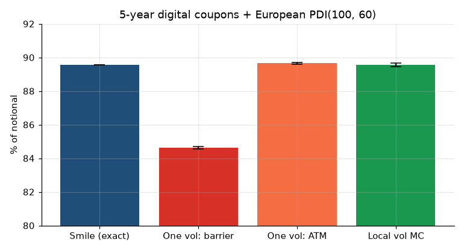
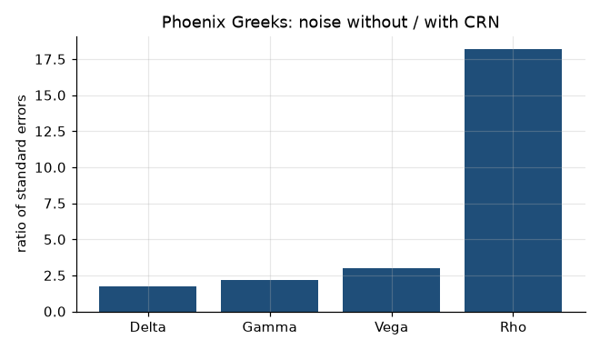
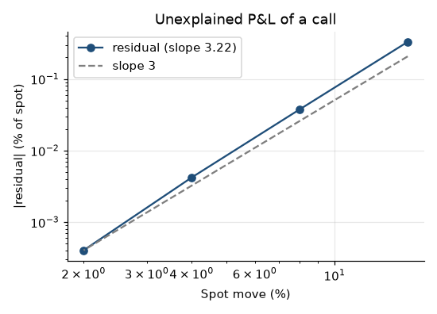

# Structured Products Pricer

[](https://github.com/maxenceherve/structured-products-pricer/actions/workflows/ci.yml)


Price, decompose, explain and hedge option strategies and structured products, in a web app
built with Dash. Written from the textbook formulas (Hull, Wilmott, Haug, Glasserman, Gatheral),
and checked against closed forms, QuantLib and Monte Carlo — every Monte Carlo number comes
with its standard error.

> Educational project. Market data are synthetic or typed by the user. Nothing here is
> investment advice.



## What you can do

The home page shows 56 products by family, each with the shape of its payoff; a search box
and a product finder lead to them. The gear at the top right, or the market line at the top of
every product page, opens the market: spot, rates, dividends, the issuer's funding spread and
the implied volatility grid, with its smile and no-arbitrage checks, shared by every page.

| Family | Products | On their page |
|---|---|---|
| **Options & strategies** | calls, puts, spreads, straddles, strangles, butterflies, condors, collars, digitals… | payoff and P&L with breakevens; legs priced on the smile (with the skew of the digitals); Greeks against the spot, against time and of second order, each explained in plain words; static hedges, a delta-hedging simulator and a P&L explain |
| **Barrier options** | the eight knock-in and knock-out options, shark warrants | the same, with the barrier observed European, American or discrete |
| **Capital protection** | participation, bearish, shark, bonus, twin-win and digital coupon notes | priced exactly by bricks read on the smile; Greeks; the issuer's hedge; a Monte Carlo check under local volatility; a solver (which participation prices the note at 98 %?) |
| **Participation certificates** | outperformance, barrier outperformance, bonus, twin-win, airbag, buffer, sprint, reverse bonus | the same, every term free: participation, strike, barrier, optional cap |
| **Yield enhancement / Autocallables** | discount certificate, reverse convertibles, barrier reverse convertibles, their autocallable versions, Athena and Phoenix | Monte Carlo under local volatility, on one underlying or a worst-of with its correlation matrix; legs on common paths; call probabilities; Greeks per underlying with their errors and the issuer's hedge; notes already alive; solver |

Every product has a printable product sheet: payoff chart, what is paid and the P&L at
maturity with the breakevens, terms, Greeks, decomposition and main risks.

The **product finder** asks for a market view, a volatility view, a horizon, the largest loss
of capital accepted at maturity (and whether a barrier is acceptable) and the kind of return,
then ranks every product with transparent rules, each point explained.

## Results, and where they come from

Every number below is produced by a test (`tests/`) or a notebook (`notebooks/`).

| Claim | Number | Source |
|---|---|---|
| Continuous barrier closed forms (8 types) agree with QuantLib | relative gap below 1e-10 | `tests/test_barrier_closed_form.py` |
| The local volatility Monte Carlo reprices the smile: 18 vanillas and digitals from 6 months to 5 years | largest gap 2.0 standard errors (200,000 paths) | `notebooks/01_pricing_and_validation.ipynb` |
| Richardson extrapolation removes the Euler bias (6-month ATM digital, weekly steps) | Euler −27.3 ± 1.8 bp, Richardson +3.5 ± 2.3 bp | notebook 01 |
| One volatility per underlying cannot price coupons and protection together (5-year digital coupons + European down-and-in put) | −4.96 ± 0.04 points at the barrier's volatility; local volatility −0.02 ± 0.05 | `notebooks/02_model_risk.ipynb` |
| Closed forms of continuous barriers use one volatility: shark notes against the local volatility | +1.02 and −1.56 points | notebook 02 |
| Common random numbers in the Monte Carlo Greeks of a Phoenix | noise divided by 1.7 (delta) to 18 (rho) | `notebooks/03_greeks_and_hedging.ipynb` |
| Spot bump for the gamma of a barrier product (against its closed form) | noise 58 % at 1 %, 11 % at 3 %, 5 % at 5 %; bias 0.0 %, −0.2 %, −0.7 % | notebook 03 |
| Delta-hedged call, realised 25 % against implied 20 % | mean P&L 1.930 ± 0.010 against a Black-Scholes price gap of 1.935 | notebook 03 |
| Hedging noise at equal volatilities | standard deviation 0.424 (daily) and 0.930 (weekly), Derman-Kamal 0.432 and 0.952 | notebook 03 |
| Taylor P&L explain | residual third order (log-log slope 3.22), step-by-step attribution exact | notebook 03, `tests/test_risk_hedging.py` |
| Every certificate and note is replicated by its bricks, and worth its expected payoff under the smile's density | payoff gap below 1e-9, value gap below 1e-6 relative | `tests/test_capital_protection.py`, `tests/test_participation.py` |
| Quality | 1240 tests, 100 % branch coverage, mypy strict, CI on Linux and Windows | `tests/`, CI |

| | |
|---|---|
|  |  |
|  |  |
|  |  |

## Design choices

- **Bricks read on the smile.** Every product that can be replicated is: zero-coupons, the
  underlying, vanillas at the volatility of their own strike, digitals with the skew term
  `−vega · dσ/dK` (a digital is the limit of a tight call spread on the same surface), barrier
  options. Levels are in % of the initial level and converted once to absolute strikes, so the
  smile is read at the true moneyness.
- **Volatility surface.** Natural cubic spline of the total variance in forward log-moneyness,
  wings bounded by Lee's moment formula and joined in C², linear in total variance across
  maturities; butterfly (Durrleman) and calendar checks; sticky strike.
- **Local volatility Monte Carlo.** Dupire's formula in total variance (Gatheral), refused when
  the surface has arbitrage; observation dates and the surface's maturities are grid nodes;
  steps grow from daily to weekly; Richardson extrapolation; Brownian-bridge extremes for
  continuous barriers; antithetic variates, standard errors on independent pairs only.
- **Notes as issuer liabilities.** Every cash flow is discounted at the rate plus the issuer's
  funding spread, while the underlying keeps the risk-free drift. Redemption is at par; the
  issue price only measures the margin.
- **Decomposition on common paths.** The legs of a Monte Carlo product (coupons, redemptions,
  the down-and-in put sold) are valued on the same paths and add up to the price exactly.
- **Greeks.** In % of notional, gamma in the "1 % gamma" convention (the change of delta for a
  1 % move). Closed forms or finite differences of closed forms; for Monte Carlo prices, bump
  and revalue on common random numbers, underlying by underlying, each Greek with its error.
- **P&L explain.** Taylor expansion at the starting point, never at the arrival; the residual
  is always shown; stress tests are full revaluations.
- **Web app.** Every callback calls a pure function, tested without a browser; a tab is
  computed only when it is shown; the market lives in the browser session.

## Layout

```
src/spricer/
  analytic/       Black-Scholes, barrier closed forms (Reiner-Rubinstein, BGK)
  market/         market, volatility surfaces, baskets, synthetic defaults
  bricks.py       zero-coupon, underlying, vanilla, digital, barrier, one-touch
  strategies.py   option strategies by family
  products/       capital protected notes, certificates and warrants, coupon notes
  mc/             paths, local volatility, correlation, products, Greeks
  greeks_lab.py   Greeks against spot and time, second order
  risk.py         P&L explain and stress matrix
  hedging.py      static hedges and delta-hedging simulation
  solve.py        solve for a term at a target price
  finder.py       product finder
  packaging.py    equivalent constructions
web/              Dash app: gallery, product pages, finder, product sheets
notebooks/        validation, model risk, Greeks and hedging (with outputs)
tests/            1240 tests
```

## Install and run

Requires Python 3.11+ and [uv](https://docs.astral.sh/uv/).

```bash
git clone https://github.com/maxenceherve/structured-products-pricer.git
cd structured-products-pricer
uv sync --all-extras
uv run python -m web.app
```

Then open http://localhost:8050. To serve it with gunicorn, or in Docker:

```bash
uv run gunicorn web.app:server --bind 0.0.0.0:8050
docker build -t spricer-web . && docker run -p 8050:8050 spricer-web
```

Checks, and the notebooks (rewritten and executed, figures saved to `docs/figures/`):

```bash
uv run pytest
uv run ruff check
uv run mypy
uv run python scripts/build_notebooks.py
```

## Limits

- Local volatility reprices every European option but not the dynamics of the forward skew, to
  which autocallables are sensitive; a stochastic volatility model would be the next step.
- Closed forms of barriers observed along the path read one volatility per strike; the Monte
  Carlo tab of each note measures the smile's effect on the barrier.
- Dividends are a continuous yield; cash dividends would need an affine model.
- The local volatility differentiates the smile twice: quotes rounded to 0.1 volatility point
  on closely spaced long-dated strikes create spikes, hence the 0.01-point default grid.
- One currency, no quanto; the issuer's funding is a flat spread.
- The product finder ranks the products of this app with transparent rules; it is a teaching
  tool, not a suitability assessment.

## References

Hull, *Options, Futures and Other Derivatives*; Wilmott, *Paul Wilmott on Quantitative
Finance*; Haug, *The Complete Guide to Option Pricing Formulas*; Glasserman, *Monte Carlo
Methods in Financial Engineering*; Gatheral, *The Volatility Surface*; Dupire (1994); Reiner and
Rubinstein (1991); Broadie, Glasserman and Kou (1997); Talay and Tubaro (1990); Derman and Kamal
(1999); Higham (2002); Gatheral and Jacquier (2014); Lee (2004).

## License

[MIT](LICENSE) — Maxence Hervé.
